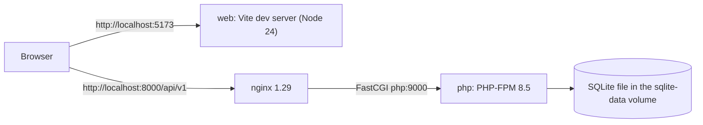
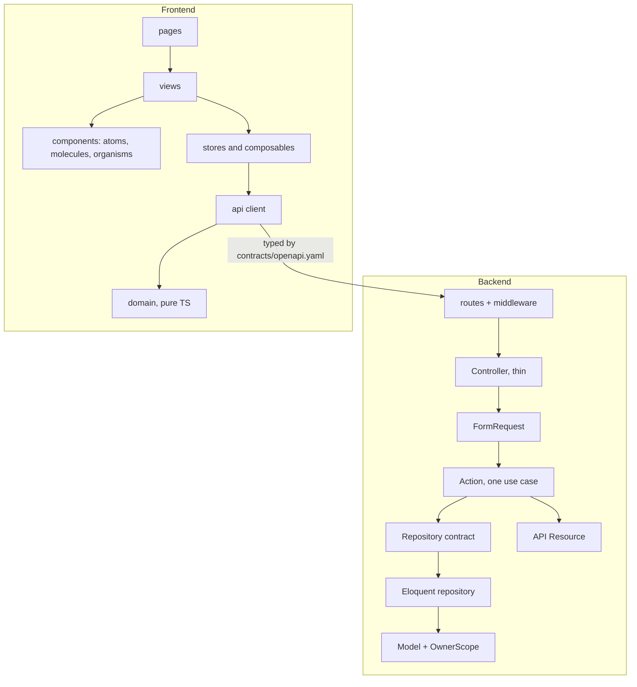
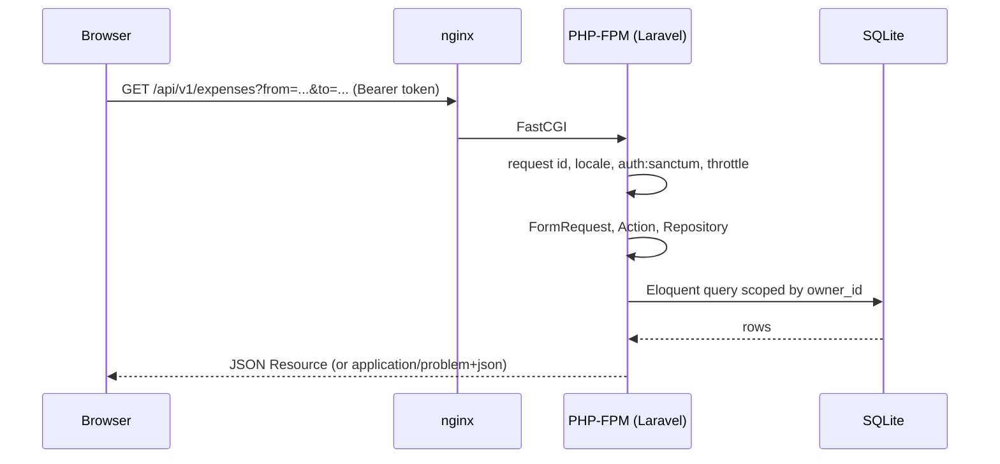

# Expenses Manager

Personal expense tracker with a statistics dashboard. This repository is a Git superproject that
pins two components as submodules:

- `backend/`: REST API in Laravel 13 (PHP), Sanctum tokens, SQLite, Pest and Larastan.
- `frontend/`: single-page app in Vue 3 and strict TypeScript, Pinia, vue-i18n and Chart.js.

The HTTP contract in `contracts/openapi.yaml` (OpenAPI 3.1) is the source of truth for both.
Rules for people and agents working on the code are in [`AGENTS.md`](AGENTS.md).

## Contents

- [Features](#features) · [Architecture](#architecture) · [Tech stack](#tech-stack)
- [Repository layout and submodules](#repository-layout-and-submodules) · [Prerequisites](#prerequisites)
- [Quick start](#quick-start) · [Manual Docker guide](#manual-docker-guide) · [Reference](#makefile-and-script-reference)
- [Seeding](#seeding) · [Tests and quality gates](#tests-and-quality-gates) · [OpenAPI workflow](#openapi-workflow)
- [i18n](#internationalization) · [Performance](#performance-notes) · [Git Flow and releases](#git-flow-and-releases)
- [Engram and Guardian Angel](#engram-and-guardian-angel) · [Troubleshooting](#troubleshooting) · [Conventions](#conventions)

## Features

- Register, sign in and sign out with bearer tokens (Sanctum); every row is isolated per owner.
- Categories: shared read-only system categories plus your own; archive instead of delete.
- Expenses: create, edit, delete, and a filtered, paginated list (period, category, text search).
- Statistics: summary, totals by category, daily/weekly/monthly time series, top expenses; cached
  per owner with strong ETags.
- Interface and API messages in Italian (default) and English; RFC 9457 problem responses.
- Health probes (`/health`, `/ready`), JSON logs with request ids, rate limits.

## Architecture

### Containers



The production compose file runs only `php` and `nginx` (API on port 8080); the SPA ships as a
separate static image (see [Production stack](#production-stack)).

### Layers



### Request flow



## Tech stack

Versions come from `backend/composer.lock`, `frontend/pnpm-lock.yaml` and the Dockerfiles.

| Area | Technology |
| --- | --- |
| Backend | PHP 8.5.7 image (code requires `^8.4`), Laravel 13.35, Sanctum 4.3, SQLite |
| Backend quality | Pest 5.3, Larastan 3.13 (PHPStan 2.3, level max), Pint 1.32, Spectator 3.0 (contract tests) |
| Frontend | Vue 3.5, TypeScript 6.0, Vite 8.3, Pinia 4.0, vue-router 5.4, vue-i18n 11.4, Chart.js 4.5, dayjs 1.11 |
| Frontend quality | Vitest 5.0, ESLint 10.12, Prettier 3.9, vue-tsc 3.3, Playwright 1.64, Lighthouse |
| Runtime | Node 24.18, pnpm 11.22, Composer 2.10, nginx 1.29, Docker Compose v2 |

## Repository layout and submodules

```text
.
├── backend/              submodule: Laravel API (own README, AGENTS.md, Makefile)
├── frontend/             submodule: Vue SPA (own README, AGENTS.md, Makefile)
├── contracts/            openapi.yaml, the contract source of truth
├── docs/                 plans, engineering report
├── scripts/              gitflow.sh, release.sh, check-readme.sh
├── .githooks/            commit-msg (Conventional Commits), pre-commit (contract drift, then gga run)
├── .engram/              shared Engram memory project and synced chunks
├── docker-compose.yml        development stack
├── docker-compose.prod.yml   production stack (API only)
├── start.sh              one-command launcher
└── Makefile
```

Fetch and update the submodules:

```bash
git clone --recurse-submodules <url> expenses_manager     # fresh clone
git submodule update --init --recursive                    # already cloned without them
git submodule update --remote --merge                      # move them to the tip of their tracked branch
```

The submodule URLs in `.gitmodules` are relative (`./backend`, `./frontend`) because the project has
no remote yet. When a remote exists, point each one at it, then commit:

```bash
git submodule set-url backend <backend-remote-url>
git submodule set-url frontend <frontend-remote-url>
git remote add origin <superproject-remote-url>
```

## Prerequisites

- Docker with Compose v2 and a running daemon (everything else runs in containers).
- `git`, `curl` and Bash 3.2 or newer for `start.sh`.
- Optional, to work outside containers: PHP 8.4+ and Composer 2, Node 24 and pnpm 11.
- Optional tooling: `engram`, `gga`, `jq`, `shellcheck`, `shfmt` (see [Engram and Guardian Angel](#engram-and-guardian-angel)).

## Quick start

```bash
git clone --recurse-submodules <url> expenses_manager
cd expenses_manager
./start.sh --demo
```

The script checks Docker and the ports, creates the `.env` files (generating `APP_KEY`), builds
and starts the stack, installs the backend dependencies, migrates, seeds, waits for
`/health`, `/ready` and the SPA, then prints the URLs. With `--demo` it also prints the demo login
(`demo@example.com` / `demo-password`). It never overwrites an existing `.env` value.

| Flag | Effect |
| --- | --- |
| `--demo` | Also run the Demo seeders (development stack only) |
| `--prod` | Use `docker-compose.prod.yml` (API only) |
| `--rebuild` | Rebuild images without the build cache |
| `--down` | Stop the stack, keep volumes |
| `--reset` | Delete the volumes after you type `reset`, then start fresh |
| `--logs` | Follow the logs (on its own it starts nothing) |
| `--test` | Run the full test suites in containers and exit |
| `--dry-run` | Print what would run, change nothing |

The API docs UI is not served yet: the backend has no Scalar or Swagger route, so the script
prints the location of `contracts/openapi.yaml` instead of a docs link (it only prints one if
`/docs` answers).

Ports are configurable. If 8000 or 5173 is taken, pick others:

```bash
API_PORT=8100 WEB_PORT=5174 ./start.sh --demo
```

## Manual Docker guide

`start.sh` only wraps these commands, which keep working on their own.

### Development stack

```bash
cp backend/.env.example backend/.env          # then set APP_KEY (php artisan key:generate)
cp frontend/.env.example frontend/.env
docker compose build
docker compose up -d --wait php
docker compose exec -T -e COMPOSER_ALLOW_SUPERUSER=1 php composer install
docker compose up -d --wait
docker compose exec -T -u www-data php touch database/sqlite/database.sqlite
docker compose exec -T -u www-data php php artisan migrate --force
docker compose exec -T -u www-data php php artisan db:seed --class='Database\Seeders\Reference\ReferenceSeeder' --force
```

Run artisan as `www-data`: files created by root in the SQLite volume are not writable by PHP-FPM.

| Service | Image or target | Host port | Healthcheck |
| --- | --- | --- | --- |
| `php` | `backend/docker/Dockerfile`, target `dev` | none | `pgrep php-fpm` |
| `nginx` | `nginx:1.29-alpine` | `API_PORT` (default 8000) | `GET /health` |
| `web` | `frontend/docker/Dockerfile`, target `dev` | `WEB_PORT` (default 5173) | `GET /` |

Volumes: `sqlite-data` (the database, mounted at `database/sqlite` in `php`) and `web-node-modules`.
The sources are bind-mounted, so edits show up without rebuilding. The SPA container receives
`VITE_API_BASE_URL=http://localhost:${API_PORT}/api/v1`, so it follows `API_PORT`.

### Production stack

```bash
docker compose -f docker-compose.prod.yml up -d --build --wait
docker compose -f docker-compose.prod.yml exec -T php php artisan migrate --force
```

Immutable images, no bind mounts, `restart: unless-stopped`, configuration from `backend/.env`
(`APP_ENV=production`, `APP_DEBUG=false`). API on `API_PORT` (default 8080), healthcheck on `/ready`;
the database lives in the `sqlite-data` volume. Set `RUN_MIGRATIONS=true` to migrate on container
start. Only reference data is seeded in production. The static frontend image is built apart
(`docker build --target prod -f frontend/docker/Dockerfile frontend`, listening on 8080 inside the
container, with `API_ORIGIN` allowed in its CSP); it is not part of this compose file.

### Environment variables

Backend (`backend/.env.example`; the file itself holds production-safe values):

| Variable | Default | Meaning |
| --- | --- | --- |
| `APP_NAME` | `Expenses Manager` | Application name |
| `APP_ENV` | `production` | Environment (`local` enables the Demo seeders in `db:seed`) |
| `APP_KEY` | empty | Encryption key; generated by `start.sh` and `php artisan key:generate` |
| `APP_DEBUG` | `false` | Debug mode |
| `APP_URL` | `http://localhost:8000` | Public API URL |
| `APP_LOCALE` / `APP_FALLBACK_LOCALE` | `it` / `en` | Default and fallback language |
| `LOG_CHANNEL` / `LOG_LEVEL` / `LOG_JSON_STREAM` | `json` / `debug` / `php://stderr` | JSON logs with a request id |
| `DB_CONNECTION` | `sqlite` | Database engine |
| `DB_BUSY_TIMEOUT` / `DB_JOURNAL_MODE` | `5000` / `WAL` | SQLite lock wait (ms) and journal mode |
| `CACHE_STORE` / `QUEUE_CONNECTION` / `SESSION_DRIVER` | `database` / `database` / `array` | Drivers |
| `SANCTUM_EXPIRATION` | `43200` | Token lifetime in minutes |
| `TRUSTED_PROXIES` | empty | Reverse proxies allowed to set `X-Forwarded-*` |
| `CORS_ALLOWED_ORIGINS` | `http://localhost:5173` | Origins allowed to call the API |
| `THROTTLE_LOGIN_PER_MINUTE` | `5` | Login attempts per email and IP |
| `THROTTLE_LOGIN_IP_PER_MINUTE` | `30` | Login attempts per IP |
| `THROTTLE_REGISTER_PER_MINUTE` | `10` | Registrations per IP |
| `THROTTLE_API_PER_MINUTE` | `120` | Authenticated requests per user |
| `THROTTLE_STATS_PER_MINUTE` | `120` | Statistics requests per user |

Stack and tooling:

| Variable | Used by | Default | Meaning |
| --- | --- | --- | --- |
| `API_PORT` | compose files, `start.sh` | `8000` dev, `8080` prod | Host port of the API |
| `WEB_PORT` | `docker-compose.yml`, `start.sh` | `5173` | Host port of the SPA |
| `VITE_API_BASE_URL` | frontend | `http://localhost:8000/api/v1` | API base URL baked into the SPA |
| `API_ORIGIN` | frontend prod image | `http://localhost:8000` | Origin allowed in the CSP `connect-src` |
| `RUN_MIGRATIONS` | backend prod entrypoint | `false` | Migrate when the container starts |
| `NO_COLOR` | `start.sh` | unset | Disable colours |

## Makefile and script reference

| Command | Purpose |
| --- | --- |
| `make setup` | Activate `.githooks` and install backend and frontend dependencies on the host |
| `make launch` | `./start.sh --demo` |
| `make up` / `make down` / `make logs` | Start, stop and follow the dev stack |
| `make test` / `make coverage` | Tests / tests with the 90% coverage gates |
| `make lint` / `make typecheck` | Pint, ESLint, Prettier / Larastan, vue-tsc |
| `make e2e` | Playwright suites |
| `make contract` / `make contract-check` | Copy the contract into both submodules / fail on drift |
| `make check-readme` | `scripts/check-readme.sh` |
| `make test-scripts` | `scripts/test-scripts.sh`: behaviour tests of `start.sh` and `check-readme.sh` (no Docker needed) |
| `make review` | `gga run --pr-mode` |
| `make memory-sync` | `engram sync` |
| `make release BUMP=patch` | `scripts/release.sh` |

Submodule targets: `make -C backend format`, `make -C frontend build`, `make -C frontend lighthouse`,
`make -C frontend e2e-fullstack`.

Scripts: `./start.sh` (above), `scripts/gitflow.sh`, `scripts/release.sh`,
`scripts/test-scripts.sh`, `scripts/check-readme.sh` (fails when this README names a `make` target, a `start.sh` flag or an
environment variable that does not exist).

## Seeding

`php artisan db:seed` always runs the **Reference** seeders (system categories; idempotent, safe in
production) and runs the **Demo** seeder only when `APP_ENV=local`. Demo data is one user,
`demo@example.com` / `demo-password`, with custom categories and 72 expenses over six months.
`start.sh` runs the seeders by class name instead, so Reference always runs and Demo only with
`--demo`:

```bash
docker compose exec -T -u www-data php php artisan db:seed --class='Database\Seeders\Demo\DemoSeeder' --force
```

## Tests and quality gates

| Area | Command | Gate |
| --- | --- | --- |
| Backend tests and coverage | `make -C backend coverage` | Pest with PCOV, at least 90% |
| Backend style / types | `make lint` / `make typecheck` | Pint; Larastan level max |
| Frontend tests and coverage | `make -C frontend coverage` | Vitest, at least 90% |
| Frontend style / types | `make lint` / `make typecheck` | ESLint and Prettier; vue-tsc |
| Build and bundle budget | `make -C frontend build` | Initial JS at most 150 kB gzip |
| E2E (mocked API) | `make e2e` | Playwright, desktop and mobile, axe checks |
| E2E (real stack) | `make -C frontend e2e-fullstack` | Needs the running dev stack |
| Lighthouse | `make -C frontend lighthouse` | Mobile performance, accessibility, best practices at least 90 |
| Contract drift | `make contract-check` | Copies identical to `contracts/openapi.yaml` |
| Everything in containers | `./start.sh --test` | Pint, Larastan, Pest, ESLint, Prettier, vue-tsc, Vitest |

Never lower a threshold or skip a hook. The first Playwright run needs a browser:
`pnpm exec playwright install chromium` (inside `frontend/`).

## OpenAPI workflow

1. Edit only `contracts/openapi.yaml`.
2. `make contract` copies it to `backend/contracts/` and `frontend/contracts/`. In `frontend/`,
   `pnpm contract` also regenerates `src/api/schema.d.ts` (never edit that file or the copies).
3. Backend feature tests validate responses against the contract (Spectator); the frontend client
   is typed by the generated schema.
4. `make contract-check` (also run by the pre-commit hook when `contracts/` is staged and by CI)
   fails on drift.

The API base path is `/api/v1`; `/health` and `/ready` live at the root. The backend does not serve
a docs UI (Scalar or Swagger) yet; open `contracts/openapi.yaml` in any OpenAPI viewer.

## Internationalization

Italian (`it`, default) and English (`en`). Add a language:

- Backend: create `backend/lang/<code>/` and add the code to `supported` in
  `backend/config/locales.php`.
- Frontend: create `frontend/src/i18n/locales/<code>.ts` with the same keys as `en.ts`, register it
  in `frontend/src/i18n/registry.ts` and add a dayjs loader in `frontend/src/lib/dates.ts`. The
  type checker and a key-parity test fail until it is complete.

Italian text is only allowed in the `it` translation files; everything else on disk is English.

## Performance notes

- Statistics use SQL aggregates on a plain `spent_on` date; week and month buckets are summed in PHP.
  Results are cached per owner under a version key bumped on every write, with a strong `ETag` and
  304 responses.
- Composite indexes on `expenses (owner_id, spent_on)` and `(owner_id, category_id, spent_on)`
  serve the list and statistics queries; the expense list runs a constant number of queries.
- SQLite runs with WAL and a 5 s busy timeout so parallel dashboard requests do not hit lock errors.
- Frontend budgets: initial JavaScript at most 150 kB gzip (checked by `pnpm build`); charts load
  lazily; Lighthouse mobile scores at least 90. Measured numbers are in `docs/ENGINEERING_REPORT.md`.

## Git Flow and releases

Every repository uses `main`, `develop`, `feature/*`, `release/*` and `hotfix/*`, and merges with
`--no-ff`. Commits follow Conventional Commits (checked by `.githooks/commit-msg`).

```bash
scripts/gitflow.sh feature start my-feature        # from develop; also: feature finish
scripts/gitflow.sh -C backend feature start my-feature
scripts/gitflow.sh hotfix start my-fix             # from main; hotfix finish merges into main and develop
scripts/release.sh patch                           # or minor | major
```

`scripts/release.sh` releases `backend`, then `frontend`, then the root: it refuses dirty trees,
computes the next `vX.Y.Z` from the last tag, updates `VERSION` and `CHANGELOG.md`, merges into
`main` with an annotated tag, back-merges into `develop`, and finally the root records the released
submodule commits. After a hotfix merge, tag it with `scripts/release.sh patch`. There are no
remotes: nothing is pushed.

## Engram and Guardian Angel

**Engram** keeps project memory for AI agents. `.engram/config.json` names the shared project
`expenses_manager` in all three repositories, so root, backend and frontend sessions share one
memory. Memories are exported as compressed chunks into `.engram/` and committed:

```bash
make memory-sync            # engram sync: export new memories to .engram/
engram sync --status        # what is pending
engram sync --import        # on a fresh clone: import the committed chunks into your local database
```

**Guardian Angel** (`gga`) reviews staged files against the "Review rules" in `AGENTS.md`.
`.gga` sets `PROVIDER="claude"`, `STRICT_MODE="true"` and `PR_BASE_BRANCH="develop"`.
Because the repositories use `core.hooksPath=.githooks`, do not run `gga install`: the
`pre-commit` hook calls `gga run` as its last step and prints a skip message when `gga` is not
installed. Review a whole branch with `make review`. Install both tools with
`brew install gentleman-programming/tap/engram gentleman-programming/tap/gga`.

## Troubleshooting

| Symptom | Cause and fix |
| --- | --- |
| `port 8000 (API) is already in use` | Another project owns it. Start with `API_PORT=8100 ./start.sh`; the SPA follows automatically. Likewise `WEB_PORT=5174` for port 5173. |
| `attempt to write a readonly database` or 500 on writes | The SQLite file was created by root in the volume. Run artisan with `-u www-data`, or `./start.sh --reset` to recreate the volume. |
| `/health` fails right after `up` | The dev image has no `vendor/` yet. Run `docker compose exec -T php composer install` (`start.sh` does it). |
| Docker daemon not reachable | Start Docker Desktop or the docker service. |
| Browser blocked by CORS | Set `CORS_ALLOWED_ORIGINS` in `backend/.env` to the SPA origin (it must match `WEB_PORT`) and restart `php`. |
| SPA calls the wrong API port | `VITE_API_BASE_URL` is fixed when the `web` container starts: recreate it with the right `API_PORT`. |
| Contract drift in the hook | Run `make contract` and commit the copies. |
| `gga` skipped in the hook | Install it (see above); the hook never blocks when it is missing. |

## Conventions

- **English only** on disk: code, comments, docs, commits, branch names, tests. Italian only in the `it` translation files.
- **TDD**: write the failing test first; every change ships with tests.
- **Strict typing**: `declare(strict_types=1)` and Larastan level max in PHP; TypeScript strict and vue-tsc in the SPA.
- **Layers**: thin controllers, logic in Actions and Services, no raw SQL, owner isolation through the global scope.
- **Definition of done**: tests pass, coverage at least 90% on the touched repository, Pint, Larastan, ESLint, Prettier and vue-tsc clean, contract in sync, docs updated, no dead code, clean tree before merge.
- Never add remotes, skip a hook (`--no-verify`) or lower a threshold.
